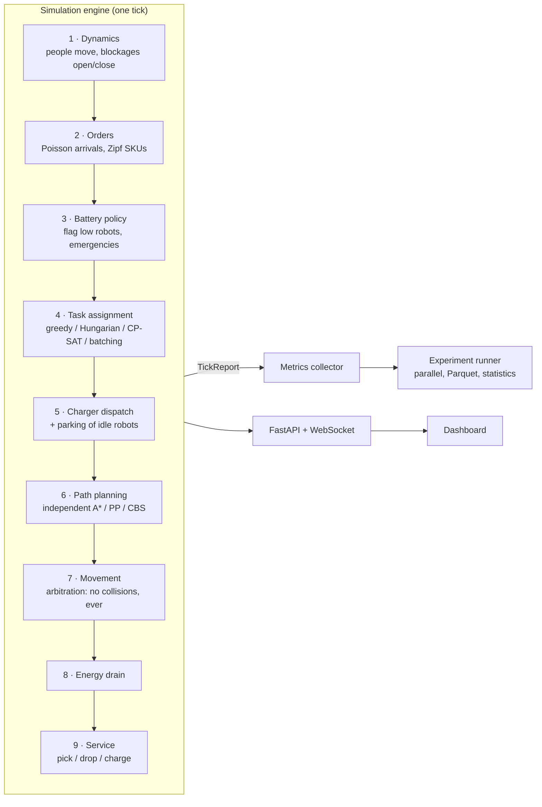
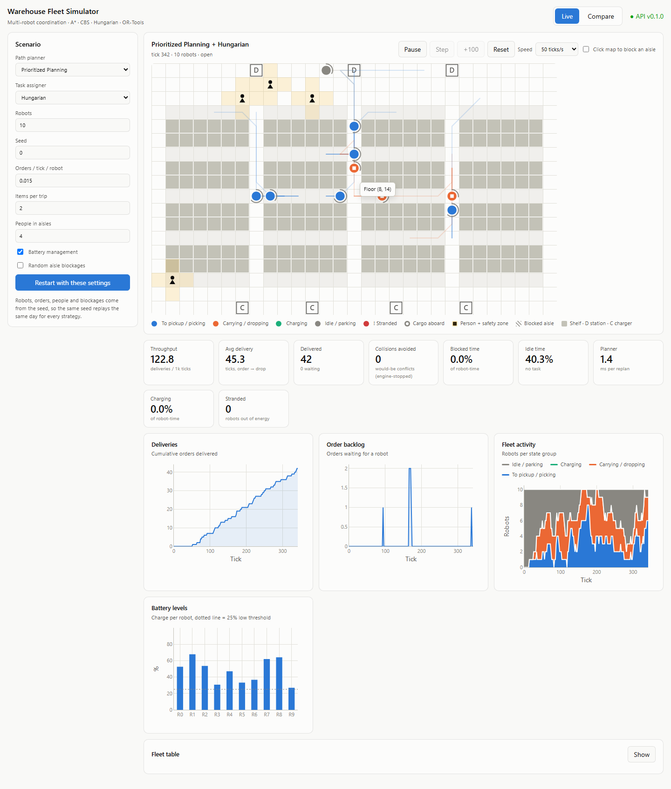
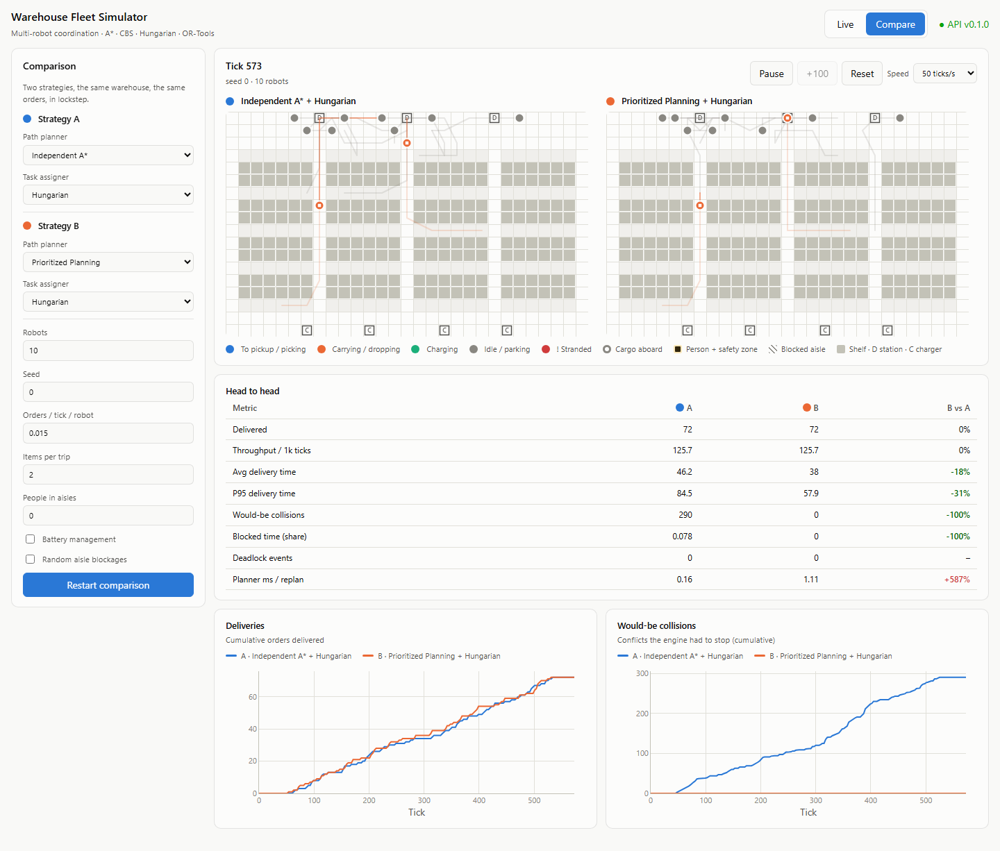
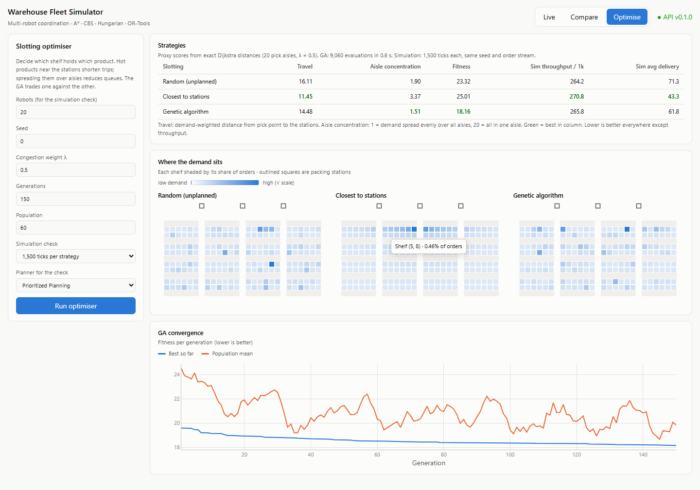
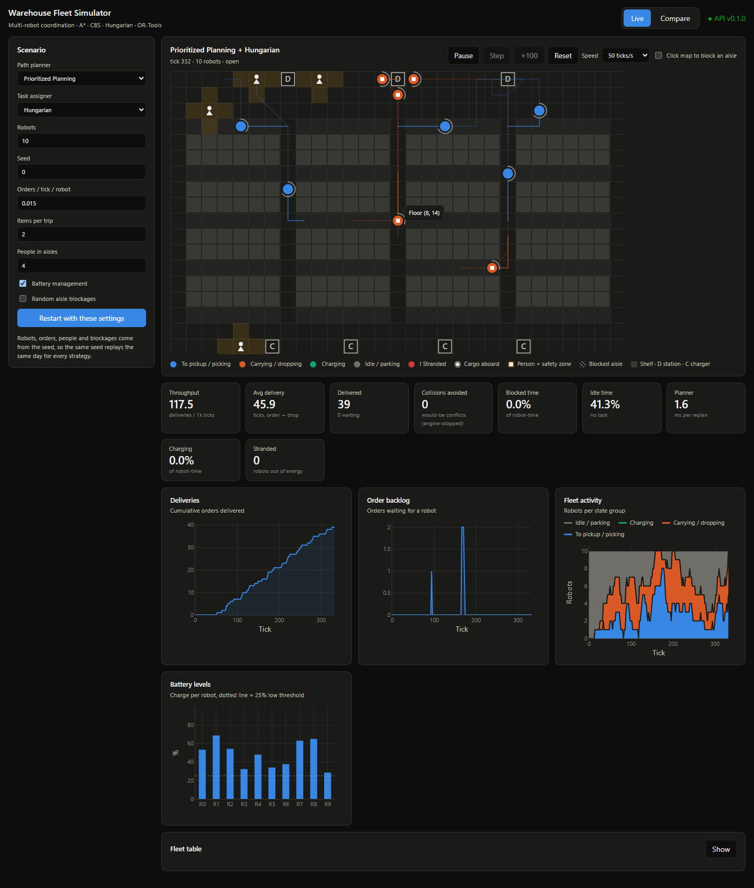

# Autonomous Warehouse Intelligence

[](https://github.com/Thilina-Samarasinghe/autonomous-warehouse-intelligence/actions/workflows/ci.yml)


A simulator and research platform for **fleets of 10–30 autonomous warehouse robots**. Robots receive orders, drive to shelves, pick items, deliver them to packing stations, recharge their batteries, and avoid people and blocked aisles. They do all of this without colliding or deadlocking.

The core question is the classic one in warehouse robotics:

> **Is it enough for every robot to plan its own shortest path, or does the fleet need coordinated, multi-agent planning?**

The project answers it with a reproducible experiment pipeline: identical order streams, 10 random seeds per configuration, and paired statistical tests. The answer is clear:

| 10 robots | Independent A\* | Coordinated (CBS) | |
|---|---:|---:|---|
| Average delivery time | 84.1 ticks | **35.9 ticks** | **−57%** |
| Collisions (would-be, per run) | 2,224 | **0** | **−100%** |
| Distance per delivery | 46.0 cells | **34.9 cells** | −24% |

| 30 robots | Independent A\* | Coordinated (CBS) | |
|---|---:|---:|---|
| Throughput (deliveries / 1k ticks) | 61.7 | **358.6** | **5.8×** |
| Runs ending in total gridlock | 7 / 10 | **0 / 10** | |

All differences: Wilcoxon signed-rank p = 0.002, Cliff's |d| ≈ 1.0. The full analysis is in **[docs/RESULTS.md](docs/RESULTS.md)**.

---

## Contents

1. [Features](#features)
2. [How it works](#how-it-works)
3. [The simulation model](#the-simulation-model)
4. [Algorithms](#algorithms)
5. [Metrics](#metrics)
6. [Results](#results)
7. [Live dashboard](#live-dashboard)
8. [Getting started](#getting-started)
9. [Command-line tools](#command-line-tools)
10. [Running experiments](#running-experiments)
11. [HTTP and WebSocket API](#http-and-websocket-api)
12. [Project structure](#project-structure)
13. [Quality and testing](#quality-and-testing)
14. [Design decisions](#design-decisions)
15. [Limitations and roadmap](#limitations-and-roadmap)
16. [References](#references)

---

## Features

| Area | What is implemented |
|---|---|
| **Simulation** | Deterministic discrete-time grid engine; procedural warehouse layouts (racks, pick aisles, cross-aisles, packing stations, chargers, parking); seeded order stream with Poisson arrivals and Zipf (ABC-style) SKU popularity |
| **Safety** | The engine is the physical arbiter: vertex (same cell) and edge (swap) conflicts can never happen. Every refused move is counted, so "collisions" can be measured without crashing anything |
| **Path planning** | Dijkstra cost-to-go maps (NetworkX), A\*, Space-Time A\*, a reactive independent planner (detour and random yield), Prioritized Planning, windowed **Conflict-Based Search** with bypass, target reasoning and a conflict-avoidance table |
| **Layout optimisation** | SKU slotting: random, travel-optimal greedy, and a **genetic algorithm** (OX1 crossover, swap/inversion mutation, tournament selection, elitism) balancing travel against aisle congestion, validated by simulation |
| **Task assignment** | Greedy FIFO baseline, **Hungarian algorithm** (SciPy), **OR-Tools CP-SAT**, **OR-Tools order batching** (pickup-and-delivery VRP; robots carry several items per trip) |
| **Energy** | Battery model (drain per move, extra drain when loaded, idle drain), feasibility check before every assignment, urgency-ordered charger queue with preemption, emergency charging with cargo aboard |
| **Dynamic obstacles** | People / forklifts walking the aisles with a robot keep-out safety zone, random temporary aisle blockages (connectivity-preserving), obstacles injected by hand via the API |
| **Metrics** | Delivery-time percentiles, throughput, would-be collisions, wait-for-graph deadlock detection, distance, idle/wait/blocked time, planner CPU time, energy KPIs, obstacle KPIs, windowed time series |
| **Experiments** | YAML specs over a planner × assigner × variant × fleet size × seed grid, parallel execution, Parquet output, paired statistics (95% CI, Wilcoxon, Mann–Whitney U, Cliff's delta) |
| **Service** | FastAPI REST API and WebSocket streaming of live frames (robots with planned paths, people, blockages, KPIs) |
| **Dashboard** | React + TypeScript + Canvas live map, run controls, click-to-block aisles, KPI tiles, Plotly charts, a side-by-side comparison of two strategies stepped in lockstep, and a slotting optimiser with demand heatmaps and GA convergence; light and dark themes |

---

## How it works



The engine knows nothing about planners or assigners. They plug in through two small interfaces (`typing.Protocol`):

```python
class PathPlanner(Protocol):
    def plan(self, world: World, requests: Sequence[PathRequest]) -> Mapping[RobotId, Sequence[Cell]]: ...

class TaskAssigner(Protocol):
    def assign(self, world: World, robots: Sequence[Robot], tasks: Sequence[Task]) -> Mapping[RobotId, TaskId | Route]: ...
```

Strategies are therefore interchangeable from a YAML file. Independent and coordinated planning run through exactly the same engine, under exactly the same physical rules.

---

## The simulation model

**The warehouse** is a 4-connected grid, generated procedurally (default: 29×18 cells, 192 shelves, 3 packing stations, 4 chargers):

```
.......D......D......D.......     D  packing / drop station (top row)
.............................
.............................
.++++++.++++++.++++++.++++++.     +  pick point: the aisle cell in front of a shelf
.######.######.######.######.     #  shelf (impassable), double-sided racks
.######.######.######.######.
.++++++.++++++.++++++.++++++.     .  floor: cross-aisles between rack segments
...                          ...
.............................
......C....C.....C....C......     C  charger (bottom row)
```

**Time** advances in ticks. Each tick, a robot moves one cell (up, down, left, right) or waits.

**A robot** runs a small state machine: `IDLE → TO_PICKUP → PICKING → TO_DROP → DROPPING → IDLE`, plus `TO_PARK` (clearing a station), `TO_CHARGER → CHARGING`, and `STRANDED` (empty battery, a policy failure, always 0 in practice). Robots follow **routes** of pick and drop stops, so a batched trip is `pick a → pick b → drop a → drop b`.

**Orders** arrive as a Poisson process. Demand per shelf follows a Zipf law (s = 1): a few "hot" shelves receive most orders, as in real ABC-classified warehouses. That concentration is exactly what creates congestion.

**Collisions are impossible by construction.** Every robot proposes its next cell, and the engine rejects any proposal that would put two robots in one cell (*vertex conflict*) or swap two robots (*edge conflict*). Blocked robots wait. This is how physical safety layers work, and it lets the simulator **count** the collisions a fleet would have had: the *would-be collision* metric.

**Determinism.** One experiment seed derives an independent random stream for each subsystem (orders, spawn positions, batteries, dynamics, planner tie-breaks). With the same seed, every planner faces the *identical* order stream. That is what makes paired comparisons valid.

**Parking.** A robot that finishes a job and gets no new one drives off the station or pick point to a parking cell. Without this rule, idle robots sitting on drop stations were the main cause of both independent-planning deadlocks and CBS search blow-ups. It is an engine rule, so it applies to every planner.

---

## Algorithms

### Dijkstra cost-to-go maps
The grid is turned into a NetworkX graph. Reverse Dijkstra runs once from every pick point, station and charger (127 goals), and each result is cached as a NumPy array of exact distances from *every* cell. These maps are reused everywhere:
- as the **A\* heuristic**, which is exact on the static map, so A\* expands only cells on an optimal path (a test checks this);
- as **true travel costs** for task assignment, instead of Manhattan distance;
- for **energy estimates** (distance to the nearest charger).

Per-cell entry costs are supported (e.g. a pick-aisle penalty), and the cost model is directional.

### A\* and the independent (reactive) baseline
Each robot plans its own optimal path (A\* with the Dijkstra heuristic) as if the warehouse were empty. Conflicts are handled *reactively*:
1. wait if the next cell is taken;
2. after 3 blocked ticks, plan a **detour** around the robots currently in the way;
3. if no useful detour exists, **yield**: step into a random free neighbour (seeded), then replan.

Random yielding breaks symmetric standoffs, such as a robot trying to leave a drop station while queued robots fill every exit. What no local rule can fix is a one-cell-wide aisle filled from both ends, where nobody has room to back out. That is why independent fleets **gridlock** at 20–30 robots.

### Space-Time A\*
The low-level search of the coordinated planners runs over states `(cell, t)` with five actions (four moves plus wait). It supports:
- **vertex constraints** `(cell, t)`, **move constraints** `(from, to, t)`, and cells blocked from a time onwards (static robots, parked robots);
- a **window** of `H` ticks (default 10). After the window, the exact static cost-to-go stands in for the rest of the path, which keeps the search small;
- **absorbing goals**: a task robot may only enter its goal if it can stay there until the window ends, because the engine starts picking the moment a robot stands on its pick point;
- a **conflict-avoidance table**: among equally short paths, it prefers the one that collides least with other robots' current plans.

### Prioritized Planning (PP)
Robots plan one at a time, longest remaining trip first. Each robot reserves its space-time path in a table that later robots must respect (vertex reservations, swap prevention, parking at the end of the path). If a robot finds no path, the failed robots move to the front and planning restarts, up to 8 times. PP is fast and incomplete, but in practice it never failed in any experiment.

### Conflict-Based Search (CBS)
CBS (Sharon et al., 2015) searches a **constraint tree**. The root holds every robot's individually optimal path. A node with a conflict branches into two children, each forbidding one of the two robots from the contested cell or move. Nodes are explored lowest total cost first. With an optimal low-level search, CBS returns a solution that minimises the **sum of costs**. Three improvements make it usable here:
- **Bypass** (Boyarski et al., 2015): if a child path costs the same but has fewer conflicts, adopt it in place instead of branching;
- **Target reasoning** (Li et al., 2020): if one robot is parked on its own goal, the other is barred from that cell for the *rest of the window* in a single branch, instead of one tick at a time. This removes an exponential chain of branches when robots share a packing station;
- an **incremental conflict count** for tie-breaking, and a conflict-avoidance table in every low-level call.

**Lifelong operation** follows the rolling-horizon approach of RHCR (Li et al., 2021). On every replan the *whole fleet* is solved for `H = 10` ticks, and robots commit to the first 4 moves. Idle robots are agents too, with "stay here" as their goal, so CBS can move them aside. Robots busy picking or dropping are static obstacles. CBS has a **deterministic node budget** (100 high-level nodes, not wall time, so runs stay reproducible). When the budget runs out it falls back to PP. The experiments show this is the decisive limit: CBS solves 95% of replans at 10 robots, but under 10% at 20–30 robots.

### Task assignment
- **Greedy (baseline):** the oldest order goes to the nearest free robot (Manhattan distance).
- **Hungarian algorithm** (Kuhn, 1955; Munkres, 1957; SciPy's `linear_sum_assignment`, Crouse, 2016): an optimal one-to-one matching that minimises `travel(robot → pickup) − 0.2 × task age`. The age term prevents starvation, and robot/task pairs the battery can't afford are excluded.
- **OR-Tools CP-SAT:** the same optimisation as an integer program (Boolean `x[r, j]`, at most one per row and column, maximise matches and then minimise cost). It reaches the same optimum as Hungarian (checked against brute force) and is the extension point for constraints Hungarian can't express.
- **Order batching** (pickup-and-delivery VRP, OR-Tools routing): each free robot is a vehicle with capacity *c*. Every order is a pickup node and a drop node, which must be served by the same robot, pickup first. Routes are open-ended, and leaving an order out costs a penalty that grows with its age. The search is deterministic (cheapest insertion followed by greedy descent, with a limit on the number of solutions). With *c* = 2 it is the strongest strategy under load.

### SKU slotting and the genetic algorithm
Which shelf holds which product matters as much as how robots drive. A *slotting* is a permutation that maps popularity ranks to shelves. Every candidate is scored on a fast proxy built from the Dijkstra maps:
- **Travel:** demand-weighted distance from each pick point to the packing stations;
- **Aisle concentration:** normalised Herfindahl index of demand per pick aisle (1 = evenly spread).

*Closest* slotting (hottest product nearest the stations) is provably optimal for travel alone. The **genetic algorithm** (Holland, 1975; Goldberg, 1989) searches permutations for the best trade-off: `fitness = travel × (1 + λ × (concentration − 1))`. Its operators are order crossover OX1 (Davis, 1985), swap and inversion mutation, size-3 tournament selection and 2-elitism, with the population seeded with the greedy solution. 60 individuals × 150 generations take about 0.6 s. The slotting changes only *which shelf* each order hits: arrival times and stations come from the same random draws, so comparisons stay paired. Candidates are then **validated in simulation**. This is what showed that the congestion term, plausible as it sounds, does not pay off (see Results).

### Battery management
- **Energy model:** 0.1 per move, +0.05 per item carried, 0.01 per tick idle, +1.0 per tick on a charger.
- **Feasibility before assignment:** a robot only takes a route if it can do `pickup → drop → nearest charger` times a 1.3 safety margin and still keep a 10% reserve.
- **Policy:** charge below 25% when free; charge up to 90%.
- **Emergency** (below 10%, or only just able to reach a charger): hand unpicked work back to the queue, **charge with the cargo still aboard**, and resume the delivery afterwards.
- **Charger dispatch:** the lowest battery goes first to the nearest free charger. An emergency robot may **preempt** a charger from a robot already above 25%.

### Dynamic obstacles
- **People / forklifts** walk the aisles (random walk with momentum) and never step into a robot.
- **Safety zone:** robots may not *enter* cells within distance 1 of a person. If a person walks up to a robot, coordinated planners move the robot back *out* of the zone, so a person can never be boxed in.
- **Aisle blockages** appear at random (3 cells for 150 ticks), and are only placed where the warehouse stays fully connected.
- **Planner response:** independent planners plan around obstacles. Coordinated planners treat them as static for the current window and replan the whole fleet whenever an obstacle blocks a robot. Paths through a new obstacle are invalidated immediately, and assigners skip orders whose pick point is blocked.

---

## Metrics

| Metric | Definition |
|---|---|
| **Throughput** | Deliveries per 1,000 ticks (after warm-up) |
| **Delivery time** | `delivered_t − created_t` per order: mean, median, P95, max |
| **Would-be collisions** | Vertex + edge conflicts among the robots' *intended* moves, counted per tick, before the engine stops them |
| **Deadlock events** | A robot that stays in a cycle of the wait-for graph (robot → robot holding the cell it wants) for 20 consecutive ticks |
| **Gridlocked run** | Zero deliveries in each of the last five 100-tick windows |
| **Distance per delivery** | Cells driven by the fleet ÷ deliveries |
| **Idle / busy / wait / blocked** | Share of robot-ticks without a task / with a task / standing still while on the way / refused by arbitration |
| **Planner CPU** | Mean and max milliseconds per planning call; CBS fallback rate |
| **Energy** | Share of time charging, sessions, energy per delivery, lowest battery seen, preemptions, stranded robots |
| **Obstacles** | Moves refused by people/blockages, paths invalidated, blockage events |

All KPIs exclude the warm-up period (the first 300 ticks by default), including orders created during warm-up.

---

## Results

Full tables, confidence intervals and discussion: **[docs/RESULTS.md](docs/RESULTS.md)**. Headline findings:

1. **Coordination removes collisions.** Prioritized Planning and CBS produced **0 conflicts and 0 blocked moves in all 60 runs** of the main experiment. Independent A\* produced 2,200 to 25,500 per run.
2. **Coordination is what lets the fleet scale.** Independent planning loses throughput as robots are added (146 → 173 → 62 for 10 → 20 → 30 robots) and gridlocks in 7/10 runs at 30 robots. Coordinated planning scales almost linearly (148 → 281 → 358).
3. **CBS beats PP only at small fleet sizes.** At 10 robots CBS delivers 26% faster than PP (p = 0.002). At 20–30 robots its node budget runs out in over 90% of replans and the two are indistinguishable. PP gives about 99% of the benefit for 10–15× less CPU.
4. **Order batching beats optimal one-to-one assignment.** With 2 items per trip, throughput is **+54%** and delivery time **−78%** at 20 robots. Hungarian beats greedy by about 5%, and CP-SAT matches Hungarian exactly.
5. **Energy management is safe and cheap.** 0 stranded robots in 80 long runs. It costs nothing at 10 robots and 5.7% at 20 robots, but halving the number of chargers costs a further 18%, so charger count must scale with fleet size.
6. **Coordinated fleets stay productive around people and blocked aisles.** 0 gridlocks in 100 obstacle runs, against 18 for independent planning. At 20 robots with 12 people, the coordinated fleet delivers **3.8× more** (p = 0.002). Blockages cost it under 1%. This depends on a robot keep-out zone around people, and on moving robots *out* of a zone when a person walks up to them. Without these, robots box people in and wait forever (see [Results §4](docs/RESULTS.md)).
7. **Where products sit matters as much as how robots drive.** Travel-optimal slotting raises independent-fleet throughput by up to **2.5×** and makes coordinated deliveries 60–80% faster. A GA that also spreads demand over aisles scores well on its proxy but *loses* in simulation. Congestion came from long trips into the racks, not from bunched demand, and simulation-based validation exposed the wrong assumption.

---

## Live dashboard



**Live view.** Pick a planner, an assigner and a scenario (fleet size, seed, order rate, items per trip, people, blockages, battery), then run, pause or step the simulation at 2–200 ticks/s.

- **The map** (HTML canvas, robots glide between ticks) shows each robot coloured by what it's doing, with its **planned path** ahead and a fading trail behind. A white square means cargo aboard, and an arc around the robot shows battery level.
- **Obstacles:** people appear with their safety zone, and blocked aisles are hatched. Tick *Click map to block an aisle* to close a cell yourself and watch the fleet replan.
- **Hover** any robot or cell for details.
- **KPI tiles and Plotly charts** (deliveries, backlog, fleet activity, battery levels) update live. A fleet table lists every robot as text.



**Compare view.** Two strategies run on **the same seed**: the same warehouse, orders, people and blockages. The browser steps both in **lockstep**, so they always show the same tick. A head-to-head table shows the relative difference for every KPI (improvements in green, regressions in red), and the charts overlay deliveries and would-be collisions. Above, after 573 ticks, both fleets have delivered 72 orders. Independent A* needed 290 engine interventions to avoid collisions; prioritized planning needed none, and delivered 18% faster.



**Optimise view.** Runs the slotting GA with your λ, generations and population, and scores random, closest and GA slotting on the proxy. It can also validate each one with a short simulation on the same seed. Demand heatmaps show where the hot products end up, and the convergence chart shows the best and mean fitness per generation. Above: the GA wins on its proxy (green fitness), but the simulation columns show closest slotting delivering faster.

Colours follow a validated palette: three categorical hues tested for colour-vision deficiency in both modes, plus a neutral gray. State is never shown by colour alone; legends, tooltips and the fleet table carry it as text. Dark mode has its own validated colour steps:

<p align="center"></p>

---

## Getting started

**Requirements:** Python 3.12, [uv](https://docs.astral.sh/uv/) (`pip install uv`), and Node.js 20.19+ (for the dashboard only).

```bash
git clone https://github.com/Thilina-Samarasinghe/autonomous-warehouse-intelligence.git
cd autonomous-warehouse-intelligence/backend
uv sync                                     # creates .venv and installs locked dependencies
uv run pytest                               # optional: run the 190+ tests
uv run awi-sim --robots 10 --ticks 1000     # first simulation
```

> **Windows tip:** if `uv` is "not recognized" after installing it, add its folder to your user PATH and open a new terminal.

Start the API and the dashboard (two terminals):

```bash
cd backend  && uv run awi-api          # http://127.0.0.1:8000/docs  (interactive API docs)
cd frontend && npm install && npm run dev   # http://localhost:5173
```

---

## Command-line tools

### `awi-sim`: a single simulation
```bash
uv run awi-sim --robots 10 --ticks 2000                                # independent A*, greedy
uv run awi-sim --robots 4 --ticks 100 --render-every 25               # ASCII frames
uv run awi-sim --planner cbs --assigner hungarian --robots 10 --ticks 1000
uv run awi-sim --planner prioritized --assigner batching --capacity 2 --ticks 1000
uv run awi-sim --planner prioritized --assigner hungarian --battery --ticks 4000
uv run awi-sim --config scenarios/stress_30.yaml --ticks 3000          # YAML scenario
uv run awi-sim --planner prioritized --assigner hungarian --slotting ga --robots 30   # GA slotting
```
Options: `--planner {astar,bfs,prioritized,cbs}`, `--assigner {greedy,hungarian,cpsat,batching}`, `--slotting {random,closest,ga}`, `--robots`, `--rate`, `--seed`, `--capacity`, `--battery`, `--pick-cost`, `--render-every`, `--config`.

ASCII legend: `#` shelf · `+` pick point · `D` station · `C` charger · `H` person · `X` blockage · `0-9a-z` robots.

### `awi-exp`: batch experiments
```bash
uv run awi-exp run scenarios/experiments/comparison.yaml --workers 6   # main experiment
uv run awi-exp report results/comparison --a cbs --b independent_astar
```

---

## Running experiments

An experiment is a YAML file that expands into the grid **planners × assigners × variants × robot counts × seeds**:

```yaml
name: dynamics
planners: [independent_astar, prioritized]
assigners: [hungarian]
robots: [10, 20]
seeds: 10                     # seeds 0..9, shared by every strategy (paired design)
ticks: 3000
warmup_ticks: 300
task_rate_per_robot: 0.015    # load grows with fleet size
variants:                     # named config overrides, deep-merged into `base`
  static: {}
  humans_6:   {dynamics: {enabled: true, humans: 6}}
  blockages:  {dynamics: {enabled: true, blockage_rate: 0.01}}
base:                         # any SimConfig field
  zipf_s: 1.0
```

Results land in `backend/results/<name>/`: `runs.parquet` (one row of KPIs per run), `timeseries.parquet` (100-tick windows) and `spec.yaml`. `awi-exp report` prints mean tables and paired comparisons: Wilcoxon signed-rank, Mann–Whitney U and Cliff's delta.

| Spec | Question | Runs | Time* |
|---|---|---:|---:|
| `smoke.yaml` | Does everything work? | 6 | 1 s |
| `baseline_sweep.yaml` | Independent A\* vs BFS at 10/20/30 robots | 60 | 1 min |
| `comparison.yaml` | **Independent vs PP vs CBS** at 10/20/30 robots | 90 | 28 min |
| `assignment.yaml` | Greedy vs Hungarian vs CP-SAT vs batching | 80 | 5 min |
| `battery.yaml` | Battery off/on, 2 vs 4 chargers, thresholds | 80 | 6 min |
| `dynamics.yaml` | People and blockages, independent vs coordinated | 200 | 8 min |
| `slotting.yaml` | Random vs closest vs GA slotting | 160 | 10 min |

\* on a 4-core i5 laptop with 6 workers.

---

## HTTP and WebSocket API

`uv run awi-api` starts the service; interactive docs are at `/docs`.

| Method | Endpoint | Purpose |
|---|---|---|
| `GET` | `/api/health` | Liveness and version |
| `GET` | `/api/options` | Available planners/assigners, default config, config JSON schema |
| `POST` | `/api/sessions` | Create a simulation `{planner, assigner, config, name, speed}` |
| `GET` | `/api/sessions` · `/api/sessions/{id}` | List / inspect sessions |
| `DELETE` | `/api/sessions/{id}` | Stop and remove a session |
| `GET` | `/api/sessions/{id}/layout` | Static map: cell types, stations, chargers, parking |
| `GET` | `/api/sessions/{id}/frame` | Current state: robots + planned paths, people, blockages, KPIs |
| `GET` | `/api/sessions/{id}/metrics` | All KPIs so far + windowed time series |
| `POST` | `/api/sessions/{id}/step` | Advance `{ticks}` (while paused) |
| `POST` | `/api/sessions/{id}/control` | `{action: start \| pause \| reset, speed}` |
| `POST` | `/api/sessions/{id}/obstacles` | Close aisle cells `{cells: [[r, c], ...], duration}` |
| `POST` | `/api/optimize/slotting` | Run the slotting GA vs random/closest, optionally validated by simulation `{config, congestion_weight, generations, population, validate_ticks, planner}` |
| `WS` | `/ws/sessions/{id}` | Live stream: `layout` message, then `frame` messages (≤ 20 fps). Accepts `{action: start\|pause\|reset\|step\|speed, ticks, speed}` |

Several sessions can run at once, for example independent vs coordinated side by side on the same seed. Simulation steps run in a worker thread under a per-session lock, so a heavy CBS tick never blocks the server. Slow WebSocket clients skip stale frames instead of slowing the simulation. Example frame (abridged):

```json
{"type": "frame", "t": 1250, "running": true, "speed": 50,
 "robots": [{"id": 3, "pos": [9, 14], "state": "to_drop", "goal": [0, 14],
             "battery": 71.4, "carrying": 1, "path": [[8, 14], [7, 14], [6, 14]]}],
 "humans": [[2, 20]], "blocked": [[6, 9], [6, 10], [6, 11]],
 "tasks": {"generated": 188, "pending": 2, "delivered": 176, "in_progress": 10},
 "kpis": {"throughput_per_1k": 149.2, "delivery_time_mean": 36.1, "conflicts_total": 0}}
```

---

## Project structure

```
backend/
  src/awi/
    core/          engine (tick loop, arbitration), grid, layout generator, robots, routes,
                   tasks, order stream, seeded RNG streams, conflicts, ASCII renderer, config
    planning/      Dijkstra maps, A*, reactive independent planner, Space-Time A*,
                   MAPF model, Prioritized Planning, CBS
    assignment/    cost model, greedy, Hungarian, CP-SAT, OR-Tools order batching
    energy/        battery model, charger dispatch
    optimization/  slotting problem (travel + aisle concentration), permutation GA
    dynamics/      people, safety zones, aisle blockages
    metrics/       per-run KPI collector and time series
    experiments/   YAML specs, parallel runner, statistics, strategy registry, CLI
    api/           FastAPI app, sessions, REST + WebSocket routes, schemas
  tests/           unit, property-based (Hypothesis) and integration tests
  scenarios/       YAML scenarios and experiment specs
frontend/
  src/api/         typed REST client and WebSocket hook (frame batching, lockstep requests)
  src/components/  warehouse canvas, Plotly wrapper, charts, KPI tiles, legends, forms, tables
  src/views/       Live, Compare and Optimise views
  src/lib/         state groups, chart history buffer, scenario mapping, theme hook
docs/              implementation plan, results
```

---

## Quality and testing

- **190+ tests, 97% coverage**, including property-based tests (Hypothesis) of the key invariants:
  - robots never share a cell or swap places, under thousands of random scenarios;
  - A\* path length equals BFS on random maps;
  - Prioritized Planning and CBS solutions are conflict-free on random instances, and an optimally solved CBS plan never costs more than PP's;
  - Hungarian and CP-SAT both match a brute-force optimum;
  - the battery policy never strands a robot;
  - robots never enter people, safety zones or blockages.
- Exact-value tests for delivery timing, warm-up handling and energy drain.
- `mypy --strict`, `ruff` lint and format, and pre-commit hooks; GitHub Actions CI on every push.
- Frontend: strict TypeScript, `oxlint`, Vitest unit tests, and a headless-browser check of both views in light, dark and phone layouts (no console errors, no horizontal overflow).
- Full determinism: same seed, same results, which is itself tested.

```bash
cd backend
uv run pytest --cov            # tests + coverage
uv run ruff check . && uv run ruff format --check . && uv run mypy
cd ../frontend
npm test && npm run lint && npm run build
```

---

## Design decisions

- **A custom engine instead of Mesa.** Multi-agent planning needs full control over the order things happen within a tick, rolling-horizon replanning and reservation tables. A small deterministic engine is simpler to reason about and test than an agent-based scheduler.
- **The engine as safety arbiter.** Planners propose and the engine enforces. Coordinated plans are *verified* each tick, not just trusted, and the collisions of a naive fleet can be measured.
- **Node budgets, not time limits.** Every experiment run is bit-for-bit reproducible. A wall-clock limit would make results depend on how busy the CPU was.
- **Windowed planning (RHCR-style).** Lifelong warehouses never "finish". Planning 10 ticks ahead and replanning every 4 keeps CBS tractable while robots receive new goals all the time.
- **Fair comparisons.** Same seeds, same order stream, same engine rules (parking, safety zones, energy) for every strategy. Only the strategy under test changes.
- **React + Canvas for the dashboard instead of Streamlit.** Streamlit's rerun model can't animate 30 robots smoothly. The backend streams compact JSON frames over a WebSocket.

## Limitations and roadmap

- The slotting GA optimises a proxy, and the experiments show its congestion term encodes the wrong mechanism. A **simulation-based fitness** (expensive, but parallelisable) or a joint optimisation of **station positions** would make the GA more than a cross-check on the greedy optimum.
- **Plain CBS does not scale past about 10–15 robots** in this setting. Bounded-suboptimal **ECBS** (Barer et al., 2014) or PBS would be the next step.
- People are treated as static within a planning window. **Predicting human motion** would let robots plan around them more smoothly. With many people, delivery times still roughly double.
- Movement is grid-based with unit-time moves; there is no rotation, acceleration or continuous kinematics.

| Phase | Status |
|---|---|
| 0–3 · Setup, engine, A\*/Dijkstra, metrics and experiment runner | ✅ |
| 4 · Space-Time A\*, Prioritized Planning, CBS | ✅ |
| 5 · Hungarian, CP-SAT, OR-Tools order batching | ✅ |
| 6 · Battery management | ✅ |
| 7 · Dynamic obstacles | ✅ |
| 8 · FastAPI REST + WebSocket streaming | ✅ |
| 9 · Live dashboard (React + Canvas + Plotly) | ✅ |
| 10 · Genetic algorithm for layout / SKU slotting | ✅ |
| 11–12 · Final report, Docker, demo | ⏳ |

---

## References

**Path planning and multi-agent pathfinding**
1. P. E. Hart, N. J. Nilsson, B. Raphael. *A Formal Basis for the Heuristic Determination of Minimum Cost Paths.* IEEE Transactions on Systems Science and Cybernetics, 4(2):100–107, 1968. (A\*)
2. E. W. Dijkstra. *A Note on Two Problems in Connexion with Graphs.* Numerische Mathematik, 1:269–271, 1959.
3. M. Erdmann, T. Lozano-Pérez. *On Multiple Moving Objects.* Algorithmica, 2:477–521, 1987. (Prioritized planning)
4. D. Silver. *Cooperative Pathfinding.* AIIDE, 2005. (Space-time reservations, windowed cooperative A\*)
5. G. Sharon, R. Stern, A. Felner, N. R. Sturtevant. *Conflict-Based Search for Optimal Multi-Agent Pathfinding.* Artificial Intelligence, 219:40–66, 2015.
6. E. Boyarski, A. Felner, R. Stern, G. Sharon, D. Tolpin, O. Betzalel, E. Shimony. *ICBS: Improved Conflict-Based Search Algorithm for Multi-Agent Pathfinding.* IJCAI, 2015. (Bypass)
7. J. Li, G. Gange, D. Harabor, P. J. Stuckey, H. Ma, S. Koenig. *New Techniques for Pairwise Symmetry Breaking in Multi-Agent Path Finding.* ICAPS, 2020. (Target reasoning)
8. M. Barer, G. Sharon, R. Stern, A. Felner. *Suboptimal Variants of the Conflict-Based Search Algorithm for the Multi-Agent Pathfinding Problem.* SoCS, 2014. (ECBS)
9. H. Ma, J. Li, T. K. S. Kumar, S. Koenig. *Lifelong Multi-Agent Path Finding for Online Pickup and Delivery Tasks.* AAMAS, 2017.
10. J. Li, A. Tinka, S. Kiesel, J. W. Durham, T. K. S. Kumar, S. Koenig. *Lifelong Multi-Agent Path Finding in Large-Scale Warehouses.* AAAI, 2021. (RHCR, rolling-horizon planning)
11. R. Stern et al. *Multi-Agent Pathfinding: Definitions, Variants, and Benchmarks.* SoCS, 2019. (Vertex and edge conflict definitions)

**Assignment, routing and warehousing**

12. H. W. Kuhn. *The Hungarian Method for the Assignment Problem.* Naval Research Logistics Quarterly, 2(1–2):83–97, 1955.
13. J. Munkres. *Algorithms for the Assignment and Transportation Problems.* Journal of the SIAM, 5(1):32–38, 1957.
14. D. F. Crouse. *On Implementing 2D Rectangular Assignment Algorithms.* IEEE Transactions on Aerospace and Electronic Systems, 52(4):1679–1696, 2016. (SciPy `linear_sum_assignment`)
15. M. W. P. Savelsbergh, M. Sol. *The General Pickup and Delivery Problem.* Transportation Science, 29(1):17–29, 1995.
16. R. de Koster, T. Le-Duc, K. J. Roodbergen. *Design and Control of Warehouse Order Picking: A Literature Review.* European Journal of Operational Research, 182(2):481–501, 2007. (Order batching, ABC demand)
17. P. R. Wurman, R. D'Andrea, M. Mountz. *Coordinating Hundreds of Cooperative, Autonomous Vehicles in Warehouses.* AI Magazine, 29(1):9–20, 2008. (Kiva Systems)

**Genetic algorithms**

25. J. H. Holland. *Adaptation in Natural and Artificial Systems.* University of Michigan Press, 1975.
26. D. E. Goldberg. *Genetic Algorithms in Search, Optimization, and Machine Learning.* Addison-Wesley, 1989.
27. L. Davis. *Applying Adaptive Algorithms to Epistatic Domains.* IJCAI, 1985. (Order crossover, OX)

**Statistics**

18. F. Wilcoxon. *Individual Comparisons by Ranking Methods.* Biometrics Bulletin, 1(6):80–83, 1945.
19. H. B. Mann, D. R. Whitney. *On a Test of Whether One of Two Random Variables Is Stochastically Larger than the Other.* Annals of Mathematical Statistics, 18(1):50–60, 1947.
20. N. Cliff. *Dominance Statistics: Ordinal Analyses to Answer Ordinal Questions.* Psychological Bulletin, 114(3):494–509, 1993.

**Software**

21. L. Perron, V. Furnon. *OR-Tools.* Google, https://developers.google.com/optimization (CP-SAT, routing).
22. P. Virtanen et al. *SciPy 1.0: Fundamental Algorithms for Scientific Computing in Python.* Nature Methods, 17:261–272, 2020.
23. A. A. Hagberg, D. A. Schult, P. J. Swart. *Exploring Network Structure, Dynamics, and Function using NetworkX.* Proceedings of the 7th Python in Science Conference (SciPy), 2008.
24. FastAPI, https://fastapi.tiangolo.com · Pydantic, https://docs.pydantic.dev · Hypothesis, https://hypothesis.works

---

*Author: Thilina Samarasinghe.*
