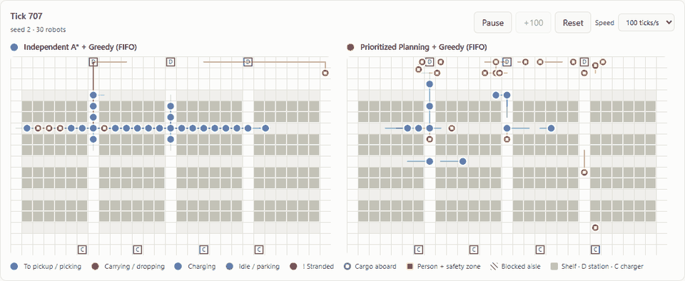

# Demo guide

A 5–10 minute live demonstration of the project, plus the commands to show it from a terminal.



*Above: the "Scaling stress" preset (30 robots, seed 2). Left, independent A\*: robots jam nose-to-tail in one aisle and deliveries stop for good. Right, prioritized planning: the coordinated fleet keeps delivering.*

---

## 1. Start everything (one command)

**Windows (PowerShell):**
```powershell
powershell -ExecutionPolicy Bypass -File scripts\demo.ps1
```

**macOS / Linux / Git Bash:**
```bash
bash scripts/demo.sh
```

The script checks for `uv` and `npm`, installs dependencies on first run, starts the API (port 8000) and the dashboard (port 5173), and opens http://localhost:5173. Press **Ctrl+C** to stop both.

<details>
<summary>Manual start (two terminals)</summary>

```bash
cd backend  && uv sync && uv run awi-api              # API: http://127.0.0.1:8000/docs
cd frontend && npm install && npm run dev            # Dashboard: http://localhost:5173
```
</details>

**Before presenting:** run each preset once so dependencies and caches are warm. Close other heavy programs; the 30-robot scenarios use one CPU core per simulation.

---

## 2. Live script (about 8 minutes)

### Scene 1: The problem (1 min), Live tab
1. Keep the defaults (Prioritized Planning + Hungarian, 10 robots) and tick **People in aisles: 4** and **Battery management**. Click **Create simulation**, set speed to **50 ticks/s**, then **Run**.
2. Point out on the map:
   - robot colours show what each robot is doing (to pickup, carrying, charging, idle);
   - a white square is cargo aboard, and the arc around a robot is its battery;
   - the thin line ahead of each robot is its **planned path**;
   - people walk the aisles with a shaded safety zone that robots never enter.
3. Tick **Click map to block an aisle** and click a few aisle cells. *"A spill: watch the robots replan around it immediately."*

### Scene 2: The core result (2 min), Compare tab → "Main experiment · 10 robots"
1. Pick the preset, click **Create comparison**, then **Run both** at 50 ticks/s.
2. Let it run to about tick 600 and read the **Head to head** table: deliveries are equal, but **would-be collisions** for independent A\* keep climbing while CBS stays at **0**, and CBS's **average delivery time** is clearly lower.
3. *"Both fleets get exactly the same orders from the same seed. Only the planning strategy differs."*

### Scene 3: Why it matters at scale (2 min), "Scaling stress · 30 robots"
1. Pick the preset, create, **Run both** at 100 ticks/s.
2. Around **tick 1,000** the left fleet jams in one aisle and its deliveries stop for good; the coordinated fleet keeps going.
3. *"This is not a slowdown, it's a collapse. Once a one-cell aisle is full from both ends, no local rule can fix it. Across 10 seeds, independent planning gridlocks in 7 of 10 runs at 30 robots; coordinated planning never does, and delivers 5.8× more."*

### Scene 4: The other levers (2 min)
- **"Order batching · 20 robots, heavy load"**: the batching strategy carries two items per trip and its waiting-order backlog stays low. *"+54% throughput across 10 seeds."*
- **"People in the aisles"**: the coordinated fleet works around people; the independent one struggles.
- **Optimise tab**: run the optimiser with the 1,500-tick simulation check. *"The genetic algorithm wins on its own score (green fitness), but the simulation columns say the simple closest-to-station layout is faster. The GA's assumption about congestion was wrong, and simulation is what caught it."*

### Scene 5: Rigour (1 min)
Open [REPORT.md](REPORT.md) at Figure 1 and Figure 3. *"670 paired runs, 10 seeds each, Wilcoxon tests. And every number can be re-checked:"*
```bash
cd backend && uv run awi-exp verify results/comparison --sample 3
# REPRODUCED: 3 runs re-run, 0 differing values
```

---

## 3. Terminal-only demo

```bash
cd backend
uv run awi-sim --robots 4 --ticks 60 --render-every 20                      # ASCII map frames
uv run awi-sim --robots 30 --ticks 2000 --seed 2 --rate 0.45                # independent: 72 delivered, gridlock
uv run awi-sim --robots 30 --ticks 2000 --seed 2 --rate 0.45 --planner prioritized   # coordinated: 730 delivered
uv run awi-sim --planner prioritized --assigner batching --capacity 2 --robots 20 --rate 0.44 --ticks 2000
uv run awi-exp run scenarios/experiments/smoke.yaml                         # a mini experiment with statistics
```

---

## 4. Troubleshooting

| Symptom | Fix |
|---|---|
| `uv` is not recognized | Add uv's folder to your user PATH and open a new terminal (see README → Getting started). |
| Dashboard says *Backend offline* | The API is not running on port 8000; start it with `uv run awi-api` in `backend/`. |
| Port 5173 or 8000 already in use | Stop the other process (`netstat -ano \| findstr :8000`, then `taskkill /PID <pid> /F`). |
| Simulation feels slow at 30 robots | Lower the speed, or use Prioritized Planning instead of CBS (10–15× cheaper per replan). |
| "at most 8 active sessions" | More than 8 sessions are *running* at once; pause or reload old tabs. Idle sessions are evicted automatically. |
