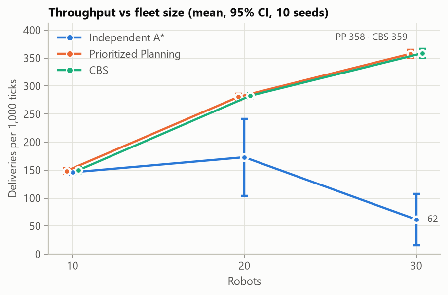
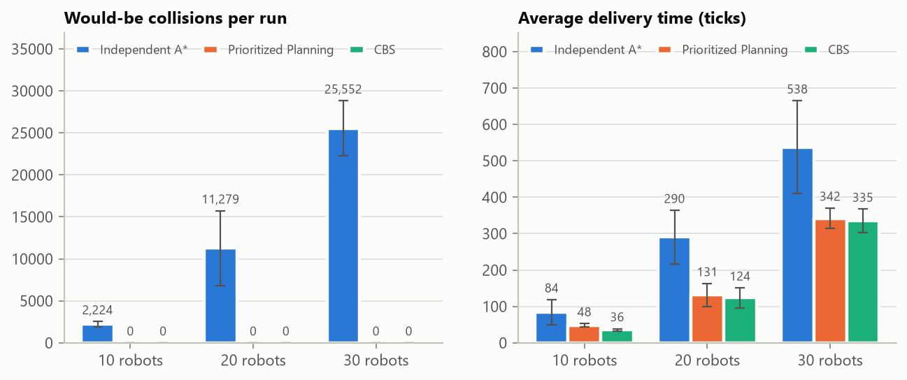
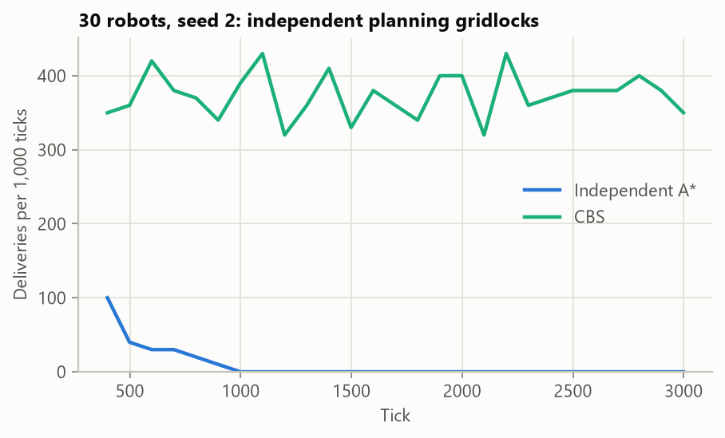
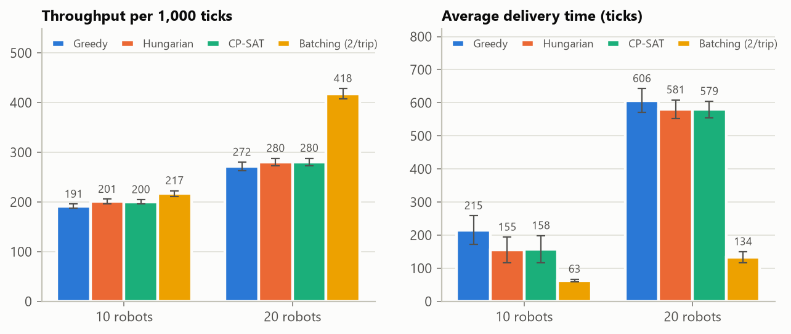
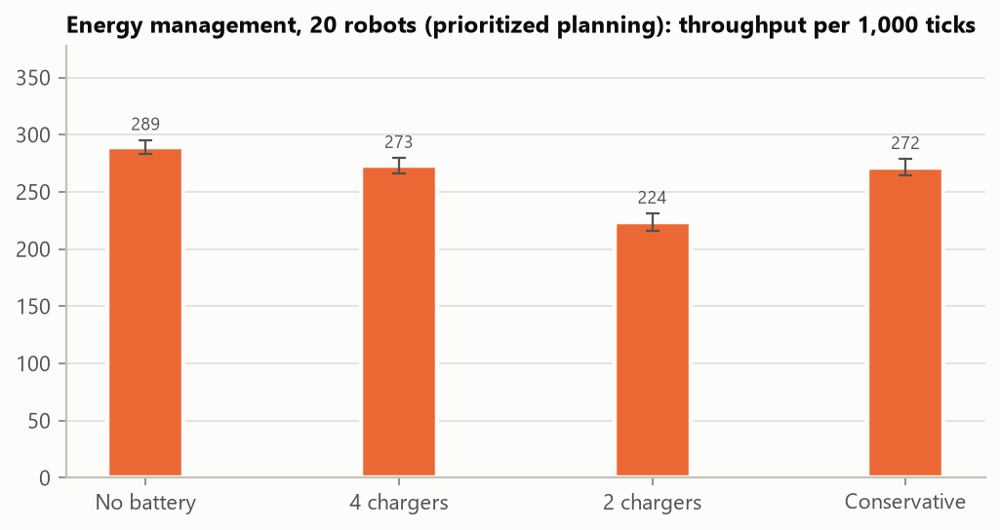
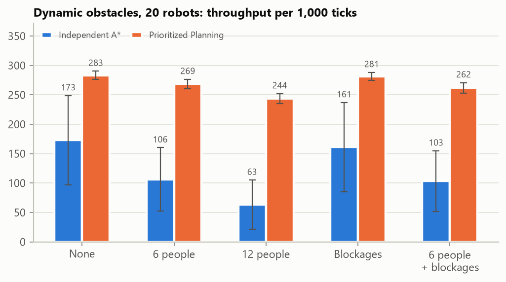
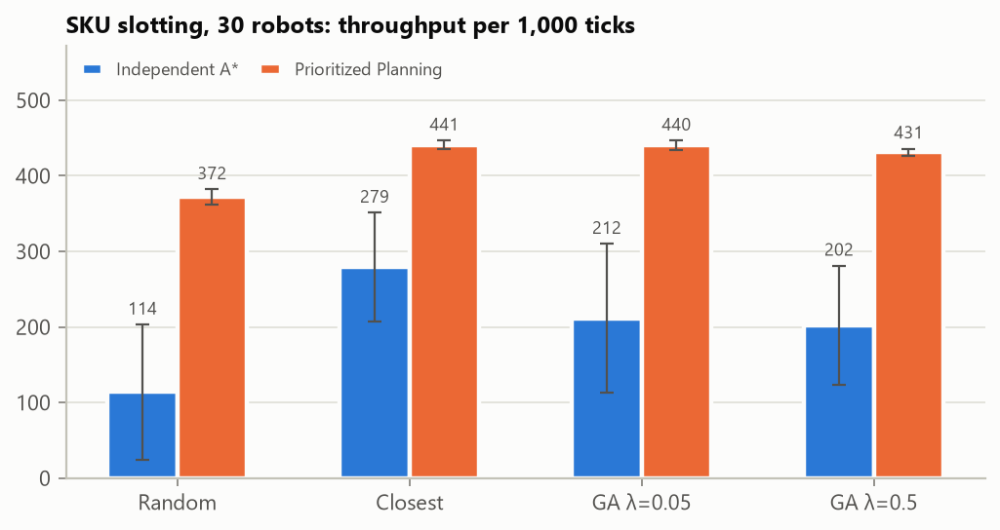

# Coordinated Fleets of Autonomous Warehouse Robots: A Simulation Study of Planning, Assignment, Energy, People and Slotting

**Author:** Thilina Samarasinghe · **Project:** Autonomous Warehouse Intelligence · **Date:** November 2026

---

## Abstract

Warehouse fleets of autonomous mobile robots must deliver orders quickly without colliding, deadlocking or running out of battery, among people and changing obstacles. This report presents a deterministic, reproducible simulation platform for fleets of 10–30 robots and uses it to answer one central question and four follow-up questions. **Is independent shortest-path planning enough, or does a fleet need coordinated multi-agent planning?**

Across 670 paired simulation runs (10 seeds per configuration, identical order streams per strategy):

- **Coordination.** Coordinated planning (windowed Conflict-Based Search and Prioritized Planning) removes *all* robot–robot conflicts. It cuts average delivery time by 57% at 10 robots, and delivers **5.8× the throughput** of independent A\* at 30 robots, where independent fleets gridlock in 7 of 10 runs.
- **Order batching.** Carrying two items per trip raises throughput by 54% under heavy load, while optimal one-to-one assignment (Hungarian, CP-SAT) gains only about 3–5% over greedy.
- **Energy.** A feasibility-checked battery policy with emergency charging and charger preemption never strands a robot, and costs 0–6% throughput.
- **People and blockages.** With a robot keep-out zone around people, coordinated fleets never gridlocked in 80 runs with people or aisle blockages (independent: 15 of 80), and delivered up to 3.8× more than independent fleets.
- **Slotting.** Travel-optimal SKU slotting raises independent-fleet throughput by up to 2.5×. A genetic algorithm that also spreads demand across aisles optimises its proxy well but *loses* in simulation, which falsifies the hypothesis that bunched demand causes congestion.

All results are bit-for-bit reproducible, and a verification command re-runs recorded experiments and checks them for exact agreement.

---

## 1. Introduction

Goods-to-person and pick-and-deliver warehouses rely on fleets of mobile robots (Wurman et al., 2008). Each robot repeatedly receives an order, drives to a shelf, picks an item and delivers it to a packing station. The hard part is not finding one robot's shortest path; it is that dozens of robots share narrow aisles. A robot that plans only for itself can block others, and in narrow aisles mutual blocking turns into deadlock.

Multi-agent pathfinding (MAPF) addresses this by planning all robots jointly (Stern et al., 2019). Optimal MAPF is NP-hard, however, and real warehouses are *lifelong*: robots receive new goals continuously, people walk the aisles, batteries drain and aisles close. This project builds a platform to study these effects together, under controlled and fair conditions.

**Research questions.**

| | Question |
|---|---|
| **RQ1** | Does coordinated planning outperform independent planning, and how does the gap scale with fleet size? |
| **RQ2** | How much do task assignment and order batching matter, compared with path planning? |
| **RQ3** | Can a battery policy guarantee that no robot runs flat, and at what cost? |
| **RQ4** | How robust are independent and coordinated fleets to people and temporary aisle blockages? |
| **RQ5** | Can a genetic algorithm find SKU slottings that improve fleet performance? |

**Contributions.**
1. A deterministic lifelong-MAPF warehouse simulator. The engine is a safety arbiter, so robot–robot collisions are physically impossible yet still *measurable*.
2. Windowed CBS with bypass, target reasoning and a conflict-avoidance table, plus Prioritized Planning, both integrated with rolling-horizon execution.
3. Assignment (greedy, Hungarian, CP-SAT, OR-Tools pickup-and-delivery batching), battery management, dynamic obstacles and slotting optimisation, all behind pluggable interfaces.
4. A paired, seeded experiment pipeline with reproducibility verification, plus a live dashboard that replays every scenario.
5. Empirical answers to RQ1–RQ5, including three engine rules discovered *through* the experiments, and one negative result.

---

## 2. Background and related work

**Path planning.** A\* (Hart et al., 1968) with an admissible heuristic finds optimal single-agent paths. Exact distance heuristics can be precomputed with Dijkstra's algorithm (Dijkstra, 1959) from every goal.

**Multi-agent pathfinding.** *Prioritized planning* (Erdmann & Lozano-Pérez, 1987) plans agents one at a time in space–time while respecting reservations; Silver (2005) introduced windowed cooperative A\*. It is fast but incomplete. *Conflict-Based Search* (Sharon et al., 2015) is optimal: a high-level search over a tree of constraints, with single-agent searches at the low level. Improvements include bypassing (Boyarski et al., 2015), symmetry reasoning for target conflicts (Li et al., 2020), and bounded-suboptimal variants such as ECBS (Barer et al., 2014).

**Lifelong MAPF.** Ma et al. (2017) formalised lifelong pickup and delivery. Li et al. (2021) showed with RHCR that planning a short window and replanning frequently scales to large warehouses. This project follows RHCR's rolling-horizon idea.

**Assignment and batching.** The Hungarian method (Kuhn, 1955; Munkres, 1957) solves one-to-one assignment optimally. Batching several orders into one trip is a pickup-and-delivery vehicle routing problem (Savelsbergh & Sol, 1995) and a core lever in order picking (de Koster et al., 2007).

**Slotting.** Assigning products to storage locations is a classic warehouse design problem (de Koster et al., 2007). Genetic algorithms (Holland, 1975; Goldberg, 1989) with permutation operators such as order crossover (Davis, 1985) are a common heuristic.

---

## 3. System design

```
Orders ──► Battery policy ──► Assignment ──► Charger dispatch / parking ──► Path planning ──► Movement arbitration ──► Energy ──► Service
 (Poisson, Zipf)               (strategy)                                    (strategy)          (no collisions, ever)
```

**Warehouse model.** The warehouse is a 4-connected grid generated procedurally. The default is 29×18 cells, with 192 shelves in double-sided racks, 20 pick aisles, 3 packing stations on the top row, 4 chargers on the bottom row, and parking cells. Each tick, a robot moves one cell or waits. Orders arrive as a Poisson process, and demand per shelf follows a Zipf law (s = 1), as in ABC-classified warehouses.

**The engine as safety arbiter.** Planners only *propose* moves. The engine rejects any move that would put two robots in one cell (vertex conflict) or swap two robots (edge conflict), and also any move into a person's safety zone or a blocked aisle. Rejected robots wait. Collisions therefore cannot happen, but every rejected *intent* is counted. This gives the *would-be collision* metric: what a fleet without central arbitration would have crashed into.

**Determinism and fairness.** One experiment seed derives an independent random stream for each subsystem: orders, spawn positions, batteries, people, planner tie-breaks and the GA. Every strategy under test sees the identical order stream. Search budgets count nodes, not wall time, so no result depends on CPU load.

**Pluggable strategies.** Path planners and task assigners implement two small `Protocol` interfaces and are selected by name from YAML experiment specs. Experiments expand over a grid of planners × assigners × config variants × fleet sizes × seeds, run in parallel, and store one Parquet row per run.

**Service and dashboard.** A FastAPI service exposes simulation sessions over REST and streams live frames over WebSocket. A React + Canvas dashboard renders the fleet, compares two strategies in lockstep on the same seed, and runs the slotting optimiser.

---

## 4. Methods

| Component | Method |
|---|---|
| Distance oracle | Reverse Dijkstra (NetworkX) from all 127 goals, cached as NumPy cost-to-go maps; an exact A\* heuristic |
| Independent baseline | Per-robot A\*. Reactive rules: wait, detour around robots after 3 blocked ticks, random yield when no detour exists |
| Low-level search | Windowed space–time A\* (horizon H = 10), with vertex and move constraints, absorbing goals and a conflict-avoidance table |
| Prioritized Planning | Longest trip first, reservation table, restarts that move failed robots to the front |
| CBS | Constraint tree with bypass, target reasoning and incremental conflict counts. 100-node budget, then fallback to PP |
| Lifelong execution | Whole-fleet replans, robots commit to 4 steps; idle robots are agents with a "stay" goal |
| Assignment | Greedy FIFO / Manhattan; Hungarian (SciPy) and CP-SAT on `travel − 0.2 × age`; OR-Tools pickup-and-delivery batching (capacity 2) |
| Energy | 0.1 per move (+0.05 per item carried), 0.01 per tick idle, +1 per tick when charging. Feasibility check `route + nearest charger` × 1.3 with a 10% reserve; emergency charging with cargo aboard; urgency-ordered dispatch with preemption |
| People and blockages | Random walk with momentum and a safety zone of radius 1; robots inside a zone are planned out of it. Connectivity-preserving 3-cell blockages lasting 150 ticks |
| Slotting | Proxy `travel × (1 + λ(concentration − 1))`. Concentration is the normalised Herfindahl index of demand per aisle. GA: OX1 crossover, swap and inversion mutation, tournament of 3, elitism of 2, population 60 × 150 generations |

Detailed explanations of every component are in the project [README](../README.md#algorithms).

---

## 5. Experimental methodology

- **Design.** Each experiment crosses its strategies with fleet sizes of 10, 20 and 30 robots, over **10 seeds** (0–9). Every strategy runs on the same seeds, so comparisons are **paired**. Runs last 3,000 ticks (6,000 for battery), and the first 300 ticks (500 for battery) are discarded as warm-up, including orders created during warm-up. Load scales with fleet size at 0.015 orders per tick per robot, or 0.022 for the assignment study.
- **Metrics.** The main metrics are:
  - throughput (deliveries per 1,000 ticks) and delivery time (order creation to drop: mean and P95);
  - would-be collisions (vertex + edge conflicts among intended moves, counted per tick);
  - deadlock events (a wait-for-graph cycle lasting 20 ticks), and gridlocked runs (no delivery in the last 500 ticks);
  - distance per delivery, idle and blocked time, planner CPU time, plus energy and obstacle KPIs.
- **Statistics.** Means are reported with t-based 95% confidence intervals. Paired differences use the Wilcoxon signed-rank test (Wilcoxon, 1945); unpaired comparisons use Mann–Whitney U (Mann & Whitney, 1947). Effect sizes are Cliff's delta (Cliff, 1993), where |d| ≥ 0.474 counts as large. With 10 pairs, the smallest attainable two-sided Wilcoxon p-value is 0.002, so "p = 0.002" means every seed agreed.
- **Reproducibility.** `awi-exp verify results/<name>` re-runs a random sample of recorded rows from the saved spec and compares every non-timing metric exactly. For this report, samples from all six experiments reproduced with **zero differing values**.

| Experiment | Spec | Runs |
|---|---|---:|
| Independent baseline (A\* vs BFS) | `baseline_sweep.yaml` | 60 |
| Independent vs PP vs CBS | `comparison.yaml` | 90 |
| Assignment strategies | `assignment.yaml` | 80 |
| Battery management | `battery.yaml` | 80 |
| People and blockages | `dynamics.yaml` | 200 |
| SKU slotting | `slotting.yaml` | 160 |
| **Total** | | **670** |

---

## 6. Results

### 6.1 RQ1: Coordinated vs independent planning



*Figure 1. Independent planning **loses** throughput as robots are added (146 → 173 → 62), while coordinated planning scales almost linearly (148 → 281 → 358). PP and CBS overlap; the series are dodged sideways so both stay visible.*



*Figure 2. Coordinated planners produced zero would-be collisions in all 60 runs; the independent fleet produced 2,224 / 11,279 / 25,552 per run. Delivery time: CBS 36 vs 84 ticks at 10 robots.*



*Figure 3. The failure mode is collapse, not gradual slowdown. Here the independent fleet stops delivering for good around tick 1,000, while CBS keeps about 380 deliveries per 1k ticks.*

| 10 robots | Independent A\* | CBS | Change | p | d |
|---|---:|---:|---:|---:|---:|
| Average delivery time | 84.1 | 35.9 | −57% | 0.002 | −1.00 |
| Would-be collisions | 2,224 | 0 | −100% | 0.002 | −1.00 |
| Distance per delivery | 46.0 | 34.9 | −24% | 0.002 | −1.00 |
| Throughput / 1k ticks | 145.9 | 149.7 | +2.6% | 0.004 | +0.37 |

**Findings.** (i) At 10 robots throughput is limited by the order rate, so both fleets serve almost every order. Coordination changes *how* they are served: less than half the delivery time, and no conflicts. (ii) At 20–30 robots, independent fleets collapse into gridlock in the aisles around hot shelves (3/10 and 7/10 runs), so coordination becomes the difference between a working fleet and a stopped one: **5.8× throughput at 30 robots** (p = 0.002, d = 1.0). (iii) CBS beats PP only at 10 robots, where it delivers 26% faster (p = 0.002). At 20–30 robots its node budget runs out in 92–98% of replans and it falls back to PP, which matches the known exponential limit of optimal CBS. (iv) The price is CPU time: 0.2 ms per replan for independent A\*, 2–33 ms for PP and 12–256 ms for CBS. PP gives about 99% of CBS's benefit for 10–15× less CPU.

### 6.2 RQ2: Assignment and batching



*Figure 4. Under heavy load with prioritized planning, Hungarian and CP-SAT beat greedy by about 5% throughput and about 28% delivery time at 10 robots. Batching two items per trip dominates: **+54% throughput and −78% delivery time at 20 robots** (p = 0.002, d = 1.0).*

Hungarian and CP-SAT reach the same optimum (a property test checks both against brute force) and are statistically indistinguishable. The one-item strategies cannot keep up with the order rate at 20 robots (61–63% of orders completed), while batching completes 94%. **Assignment matters, but *what* a robot carries matters far more than *which* robot is chosen.**

### 6.3 RQ3: Energy management



*Figure 5. Over 6,000 ticks with several charge cycles, no robot was ever stranded (0 in 80 runs; lowest battery seen 4.5%). Energy management costs nothing at 10 robots and 5.7% at 20 robots. Halving the chargers costs a further 18%, and a conservative policy (charge below 40%) costs nothing measurable.*

The experiment first *failed*: an earlier policy stranded up to 7 robots per run. Under traffic, a delivery leg can take 10× longer than its shortest path (one took 192 ticks for about 15 cells), so up-front energy estimates are not sufficient. Two mechanisms fixed it: **emergency charging with cargo aboard**, and **charger preemption** by emergency robots.

### 6.4 RQ4: People and blocked aisles



*Figure 6. At 20 robots, coordinated planning delivers +152% (6 people), +284% (12 people) and +75% (blockages) more than independent planning (all p = 0.002, d ≥ 0.95). Coordinated fleets never gridlocked in their 80 runs with people or blockages; independent fleets did in 15.*

Blockages are nearly free for a coordinated fleet (−0.2% to −0.7%, not significant), because the whole fleet replans around a closed aisle within one commit window. People are harder: they move unpredictably and the planner only knows where they are *now*. Two rules were necessary, both found by this experiment and its property tests. **(a) A safety zone around people:** without it, robots queued tightly around a person in a one-cell aisle, the person could never move again, and half the 12-person runs gridlocked. **(b) Moving robots out of a zone a person walks into**, so a person can never be boxed in between two waiting robots.

### 6.5 RQ5: Slotting and the genetic algorithm



*Figure 7. Travel-optimal ("closest") slotting raises 30-robot independent throughput from 114 to 279 (+145%) and coordinated throughput from 372 to 441 (+18%), with 60–80% faster deliveries. The GA with a congestion penalty never beats closest, and is significantly worse at λ = 0.5.*

On its proxy the GA works as designed. It runs in about 0.6 s, reproduces the provable optimum at λ = 0, and at λ = 0.5 finds slottings with 20% less travel than random and 56% less aisle concentration than closest. In simulation, though, spreading demand across aisles never pays off. **The hypothesis behind the proxy was wrong.** Congestion did not come from hot products being bunched together. It came from robots driving *deep into* the racks to reach randomly placed hot shelves, through pick aisles used by everyone. Closest slotting keeps the busiest traffic in the open zone next to the stations.

---

## 7. Discussion

**Coordination is a scaling requirement, not an optimisation.** At low density, independent planning is "only" slower. Beyond about 15 robots on this layout it fails catastrophically, and no local rule can fix it: once a one-cell aisle fills from both ends, nobody can back out. Coordinated planning prevents the situation from arising.

**Prioritized Planning is the practical choice.** Optimal CBS is worth its cost only for small groups. A deployable system would use PP, or a bounded-suboptimal CBS variant, inside a rolling horizon.

**The biggest levers are not the planner.** Ranked by effect at 20–30 robots: coordinated planning (up to 5.8×), slotting (up to 2.5× for independent fleets), batching (+54%), and optimal one-to-one assignment (+3–5%). A real deployment should treat layout and order release as first-class design decisions, not as fixed inputs to the fleet controller.

**Experiments as a design tool.** Three engine rules came out of experimental failures, not up-front design: parking idle robots off stations, safety zones that keep people movable, and emergency charging with preemption. Each was found by looking at *why* a run failed (a stalled CBS search, a gridlocked aisle, a stranded robot) and then confirmed by re-running the full experiment. The slotting study is the reverse case: a well-optimised proxy built on a wrong assumption, exposed by simulation. Validating optimisers in the real loop, which the dashboard's Optimise view also does, is essential.

---

## 8. Threats to validity

- **Abstraction.** The model is a grid with unit-time moves: no kinematics, rotation, acceleration or sensing noise. Absolute numbers will not transfer to a physical fleet; relative comparisons are more robust.
- **One layout and synthetic demand.** All results use one procedurally generated layout family and independent single-line orders with Zipf demand. Order affinity (products ordered together), multi-line orders and other layouts could change the slotting and batching results in particular.
- **Baseline strength.** The independent baseline uses reasonable reactive rules (detour, random yield). More elaborate local deadlock resolution would narrow, but not close, the gap at high density.
- **Parameters.** The CBS budget, window size, battery thresholds and GA λ were tuned in exploratory runs before the final experiments. Different values shift some results, the CBS fallback rate in particular.
- **Statistics.** Each configuration has 10 seeds and many comparisons are reported without multiple-comparison correction. The headline effects (p = 0.002, |d| ≥ 0.9) are far from any reasonable threshold; small effects (|d| < 0.33) should be read as tentative.

## 9. Future work

1. **Scalable coordination:** ECBS or PBS to keep near-optimal plans beyond 15 robots.
2. **Predicting human motion**, so robots plan around people's likely paths instead of their current cell.
3. **Simulation-in-the-loop optimisation:** evolve slotting, and jointly the positions of packing stations and chargers, with a parallel simulation-based fitness.
4. **Richer demand:** multi-line orders and product affinity, which make batching and slotting interact.
5. **Continuous kinematics and real maps**, to calibrate against physical fleets.

## 10. Conclusion

Independent shortest-path planning is not enough for warehouse robot fleets beyond small sizes. It wastes time at low density and collapses into gridlock at high density. Coordinated multi-agent planning removes every robot conflict, scales fleet throughput almost linearly, and stays robust when batteries, people and blocked aisles are added, provided the system enforces a few simple rules that the experiments themselves revealed. Fleet performance depends as much on where products are stored and how orders are batched as on how robots move. All conclusions are backed by 670 paired, reproducible runs, which anyone can re-run and verify with the commands in the appendix.

---

## References

1. Barer, M., Sharon, G., Stern, R., & Felner, A. (2014). Suboptimal variants of the Conflict-Based Search algorithm for the multi-agent pathfinding problem. *SoCS*.
2. Boyarski, E., Felner, A., Stern, R., Sharon, G., Tolpin, D., Betzalel, O., & Shimony, E. (2015). ICBS: Improved Conflict-Based Search algorithm for multi-agent pathfinding. *IJCAI*.
3. Cliff, N. (1993). Dominance statistics: Ordinal analyses to answer ordinal questions. *Psychological Bulletin*, 114(3), 494–509.
4. Davis, L. (1985). Applying adaptive algorithms to epistatic domains. *IJCAI*.
5. de Koster, R., Le-Duc, T., & Roodbergen, K. J. (2007). Design and control of warehouse order picking: A literature review. *European Journal of Operational Research*, 182(2), 481–501.
6. Dijkstra, E. W. (1959). A note on two problems in connexion with graphs. *Numerische Mathematik*, 1, 269–271.
7. Erdmann, M., & Lozano-Pérez, T. (1987). On multiple moving objects. *Algorithmica*, 2, 477–521.
8. Goldberg, D. E. (1989). *Genetic Algorithms in Search, Optimization, and Machine Learning*. Addison-Wesley.
9. Hart, P. E., Nilsson, N. J., & Raphael, B. (1968). A formal basis for the heuristic determination of minimum cost paths. *IEEE Transactions on Systems Science and Cybernetics*, 4(2), 100–107.
10. Holland, J. H. (1975). *Adaptation in Natural and Artificial Systems*. University of Michigan Press.
11. Kuhn, H. W. (1955). The Hungarian method for the assignment problem. *Naval Research Logistics Quarterly*, 2(1–2), 83–97.
12. Li, J., Gange, G., Harabor, D., Stuckey, P. J., Ma, H., & Koenig, S. (2020). New techniques for pairwise symmetry breaking in multi-agent path finding. *ICAPS*.
13. Li, J., Tinka, A., Kiesel, S., Durham, J. W., Kumar, T. K. S., & Koenig, S. (2021). Lifelong multi-agent path finding in large-scale warehouses. *AAAI*.
14. Ma, H., Li, J., Kumar, T. K. S., & Koenig, S. (2017). Lifelong multi-agent path finding for online pickup and delivery tasks. *AAMAS*.
15. Mann, H. B., & Whitney, D. R. (1947). On a test of whether one of two random variables is stochastically larger than the other. *Annals of Mathematical Statistics*, 18(1), 50–60.
16. Munkres, J. (1957). Algorithms for the assignment and transportation problems. *Journal of the SIAM*, 5(1), 32–38.
17. Savelsbergh, M. W. P., & Sol, M. (1995). The general pickup and delivery problem. *Transportation Science*, 29(1), 17–29.
18. Sharon, G., Stern, R., Felner, A., & Sturtevant, N. R. (2015). Conflict-based search for optimal multi-agent pathfinding. *Artificial Intelligence*, 219, 40–66.
19. Silver, D. (2005). Cooperative pathfinding. *AIIDE*.
20. Stern, R., et al. (2019). Multi-agent pathfinding: Definitions, variants, and benchmarks. *SoCS*.
21. Wilcoxon, F. (1945). Individual comparisons by ranking methods. *Biometrics Bulletin*, 1(6), 80–83.
22. Wurman, P. R., D'Andrea, R., & Mountz, M. (2008). Coordinating hundreds of cooperative, autonomous vehicles in warehouses. *AI Magazine*, 29(1), 9–20.

---

## Appendix A: Reproducing this report

```bash
cd backend
uv sync --extra report
for spec in baseline_sweep comparison assignment battery dynamics slotting; do
  uv run awi-exp run scenarios/experiments/$spec.yaml --workers 6     # ~1 h in total on a 4-core laptop
done
uv run awi-exp figures --results results --out ../docs/figures       # Figures 1–7
uv run awi-exp verify results/comparison --sample 5                  # exact re-run check
uv run awi-exp report results/comparison --a cbs --b independent_astar
```

Full tables with confidence intervals and every pairwise test are in [RESULTS.md](RESULTS.md).

## Appendix B: Software

Python 3.12 · NumPy 2.5 · SciPy 1.18 · NetworkX 3.7 · OR-Tools 9.15 · pandas 3.1 · Pydantic 2.14 · FastAPI 0.162 · matplotlib 3.11 · React 19 · TypeScript 7 · Vite 8 · Plotly.js 3.7.

Codebase: about 5,800 lines of backend code in 56 modules, 2,600 lines of tests (190+ backend tests including Hypothesis property tests, 97% coverage, `mypy --strict`), and 2,800 lines of dashboard code with Vitest unit tests.
